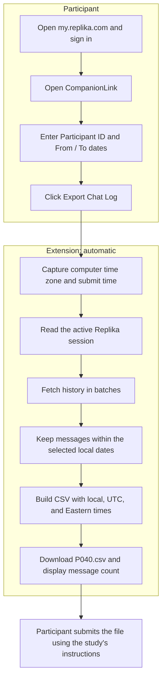

# Replika Export: Visual Workflow

The participant chooses the account, Participant ID, and dates. The extension
retrieves the selected chat history and creates the correctly named CSV locally.

## Export Flow

The participant keeps the popup open until the download is confirmed. File
submission is separate from the extension; it does not send chat logs to the lab.

## Export Rules

- Each history request asks for up to 1,000 messages. The extension requests older
  batches until it crosses the From boundary or the server returns no messages.
- Both selected local dates are included. A date begins at its first actual
  instant, including when daylight saving time skips midnight. A To date of today
  is capped at submit time.
- The captured computer time zone is used throughout the export. It does not
  establish where the participant was when earlier messages occurred.
- CSV rows are newest first. Dates with no messages give a file with only the column
  names.
- Session credentials are used for requests to Replika, not written to the CSV or
  sent to the research team.

See the [CSV format](../technical-notes.md#csv-format),
[Participant Instructions](participant-guide.md), and
[Researcher Guide](researcher-guide.md) for details.
