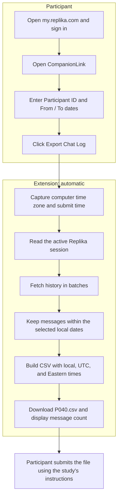

# Replika Export: Visual Workflow

The participant chooses the account, Participant ID, and dates. The extension
retrieves the selected chat history and creates the correctly named CSV locally.

## Export Flow

The participant keeps the popup open until the download is confirmed. File
submission is separate from the extension; it does not send chat logs to the lab.

## What Is Automated

| Task | Previous manual workflow | Current extension |
| --- | --- | --- |
| Access the signed-in session | Copy the v17 init message from DevTools into `chat_backup.ini` | Read the active Replika session in the browser |
| Retrieve chat history | Run `chat_backup.py` | Request history through Replika's v17 WebSocket |
| Define the study window | Requires separate date handling in the manual workflow | Apply the selected From / To dates in the detected computer time zone |
| Prepare the file | Python writes the legacy CSV | Create the current eight-column CSV with text, reactions, and time references |
| Name the file | Rename the output manually | Normalize Participant ID; `040` becomes `P040.csv` |
| Deliver the file to researchers | Participant submits the file | Participant still submits the file |

## Export Rules

- Each history request asks for up to 1,000 messages. The extension requests older
  batches until it crosses the From boundary or the server returns no messages.
- Both selected local dates are included. A date begins at its first actual
  instant, including when daylight saving time skips midnight. A To date of today
  is capped at submit time.
- The captured computer time zone is used throughout the export. It does not
  establish where the participant was when earlier messages occurred.
- CSV rows are newest first. An empty date window produces a header-only CSV.
- Session credentials are used for requests to Replika, not written to the CSV or
  sent to the research team. No Python installation or manual file renaming is needed.

See the [CSV format](../../README.md#output-format),
[Participant Instructions](participant-guide.md), and
[Researcher Guide](researcher-guide.md) for details.
