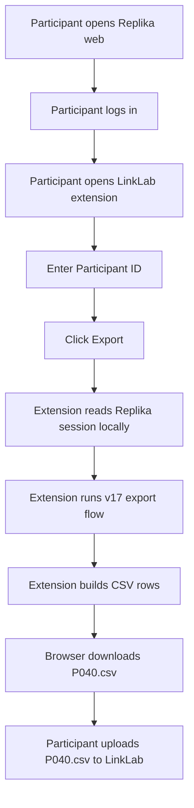
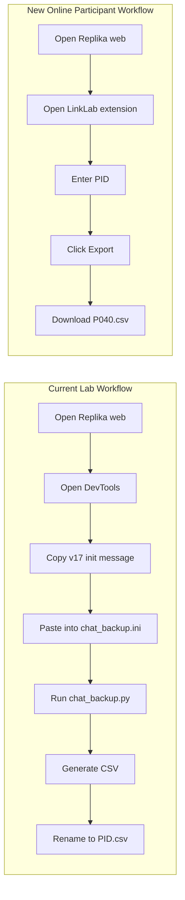
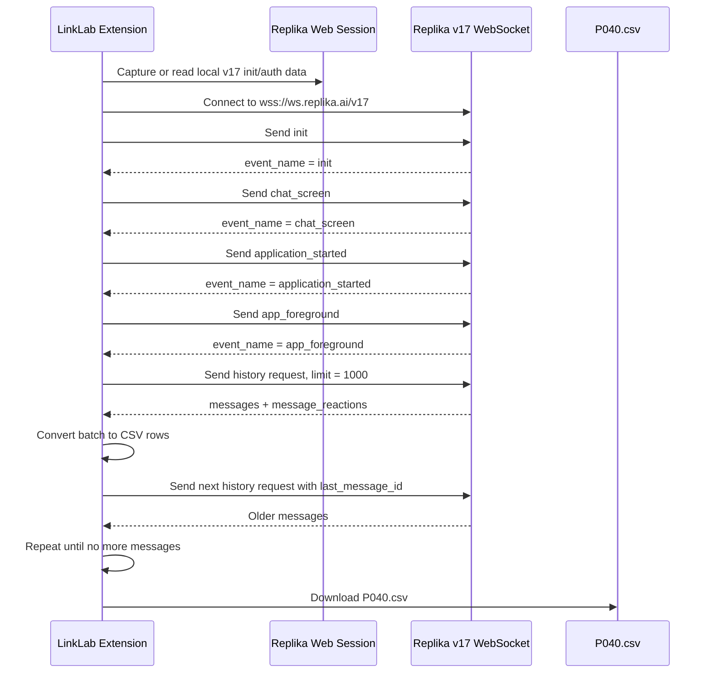
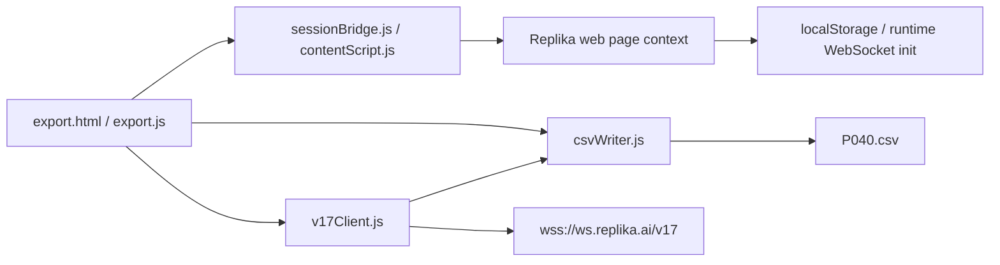
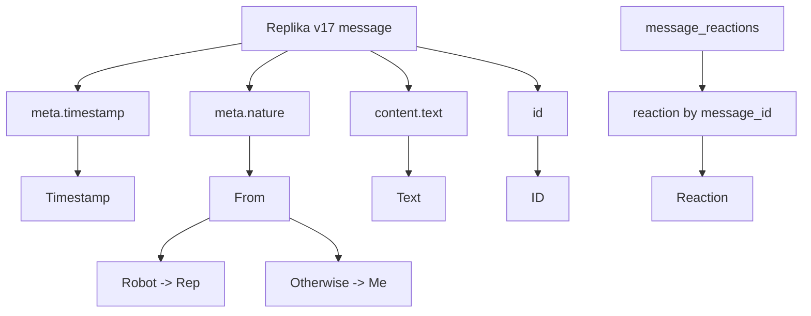
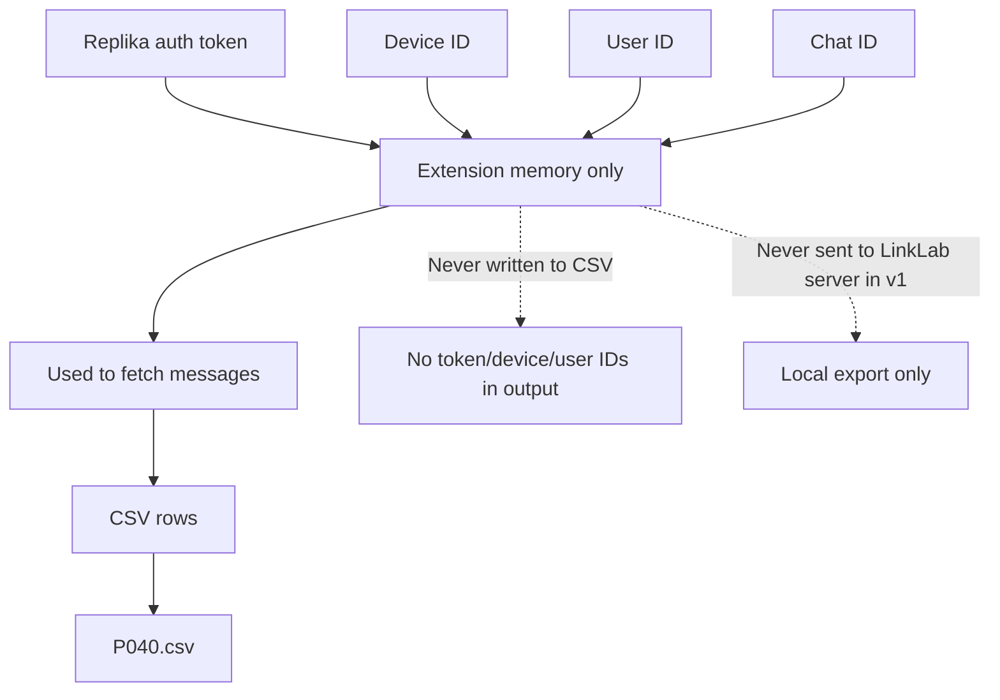
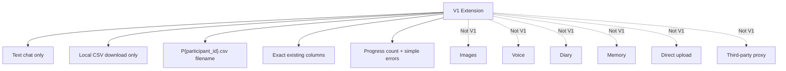

# Replika Online Export Tool: Visual Workflow And Architecture

## Goal

Replace the current manual lab workflow:

```text
Replika web
-> DevTools
-> copy v17 init message
-> paste into chat_backup.ini
-> run chat_backup.py
-> generate CSV
-> rename CSV to PID.csv
```

with an online-participant workflow:

```text
Replika web
-> LinkLab Chrome extension
-> download P{participant_id}.csv
-> upload P{participant_id}.csv to LinkLab
```

The extension should preserve the current CSV format exactly:

```csv
Timestamp,From,Text,Reaction,ID
```

## Behavioral Reference

Use the current lab script as the behavioral reference for v1:

```text
C:\Users\linpe\SyracuseUniversity\LinkLab\Replika_Chatlog\replika_backup-main\chat_backup.py
```

The extension should replace the participant-hostile parts of that workflow, not change the data contract. Preserve the script's CSV behavior, including New York timestamp formatting, `Robot -> Rep`, non-`Robot -> Me`, missing reactions as `None`, literal `\n` for message newlines, and the newest-to-oldest `.no.csv` order unless the user explicitly changes that requirement.

## First Principles Summary

Core problem: online participants need to produce the same participant-named CSV your lab already uses, without DevTools, `.ini` editing, running Python, or manually renaming files.

Success criteria:

- Participant logs into Replika web in their own browser.
- Participant enters Participant ID once, such as `040`.
- Tool downloads `P040.csv`.
- CSV exactly matches the current five-column format.
- No Replika password, auth token, device ID, email, or profile data leaves the browser.

Ground truths:

- The current working source of truth is `chat_backup.py`.
- The downstream lab pipeline expects the current CSV shape.
- `chat_backup.py` uses Replika v17 WebSocket, not an official export API.
- Participants cannot reasonably use DevTools or Python.
- Local CSV export is safer than direct upload for v1.

## Participant Workflow



Explanation:

The participant should not touch DevTools, Python, `.ini` files, or filenames. They only log into Replika, enter their participant ID, click export, and upload the downloaded CSV. If the participant enters `040`, the downloaded filename is `P040.csv`; if they enter `P040`, the downloaded filename is still `P040.csv`.

## Current Manual Workflow vs New Tool



Explanation:

The Chrome extension replaces the fragile manual middle steps. It should behave like a browser-based version of `chat_backup.py`, not like a new data pipeline.

## Internal v17 WebSocket Flow



Explanation:

This mirrors `chat_backup.py`. The extension should send the same event sequence before requesting history, then page through history using `last_message_id`.

## Component Architecture



Explanation:

Suggested extension modules:

- `export.html / export.js`: participant UI, participant ID entry, consent/warning, progress.
- `sessionBridge.js / contentScript.js`: obtains the same local v17 init/auth values currently copied from DevTools, without persisting them.
- `v17Client.js`: mirrors the `chat_backup.py` WebSocket flow.
- `csvWriter.js`: converts messages to the existing CSV format and downloads `P{participant_id}.csv`.

## CSV Mapping



Explanation:

The CSV must match the current lab format exactly:

```csv
Timestamp,From,Text,Reaction,ID
```

Mapping rules:

```text
meta.timestamp
  -> Timestamp
  -> convert UTC to America/New_York
  -> format "%Y-%m-%d %H:%M:%S"

meta.nature == "Robot"
  -> From = "Rep"

otherwise
  -> From = "Me"

content.text
  -> Text
  -> replace newline with literal "\n"

message_reactions[message.id]
  -> Reaction

missing reaction
  -> Reaction = "None"

message.id
  -> ID
```

## Output Contract

Filename:

```text
P{participant_id}.csv
```

Examples:

```text
040 -> P040.csv
P040 -> P040.csv
p040 -> P040.csv
```

CSV columns:

```csv
Timestamp,From,Text,Reaction,ID
```

Example:

```csv
Timestamp,From,Text,Reaction,ID
2026-07-08 16:36:40,Rep,"It sounds like you're ...",None,6a4eb4d28ba01956
2026-07-08 16:36:32,Me,"Sometimes I think it ...",None,6a4eb4d0e09db10a
```

Rows should remain newest-to-oldest, matching `chat_backup.py`'s `.no.csv` behavior and the current screenshot.

## Data Boundary



Explanation:

For v1, the extension should not upload directly. It should only download a local CSV. Replika auth/session values are used temporarily and should not be included in the CSV.

## V1 Scope



Explanation:

Keep v1 narrow. The mission is to replace the current manual `chat_backup.py` workflow for online participants, not to build a full Replika data platform.

## Recommended Build Shape

```text
linklab-replika-exporter/
  extension/
    manifest.json
    export.html
    export.js
    sessionBridge.js
    contentScript.js
    pageBridge.js
    v17Client.js
    csvWriter.js

  docs/
    participant-instructions.md
    architecture.md
```

V1 deliverable:

```text
Chrome extension downloads P{participant_id}.csv in the exact current lab format.
```
